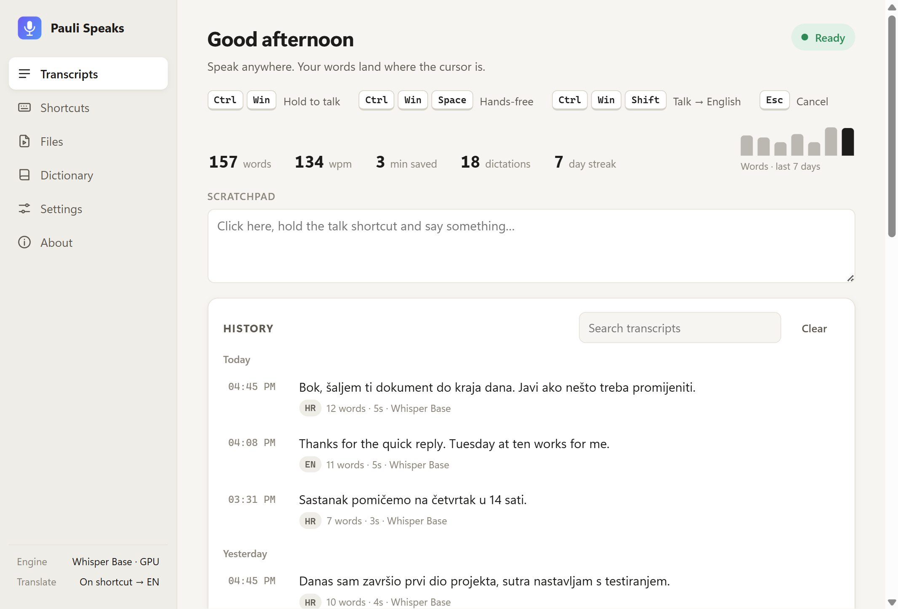
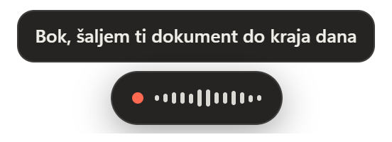
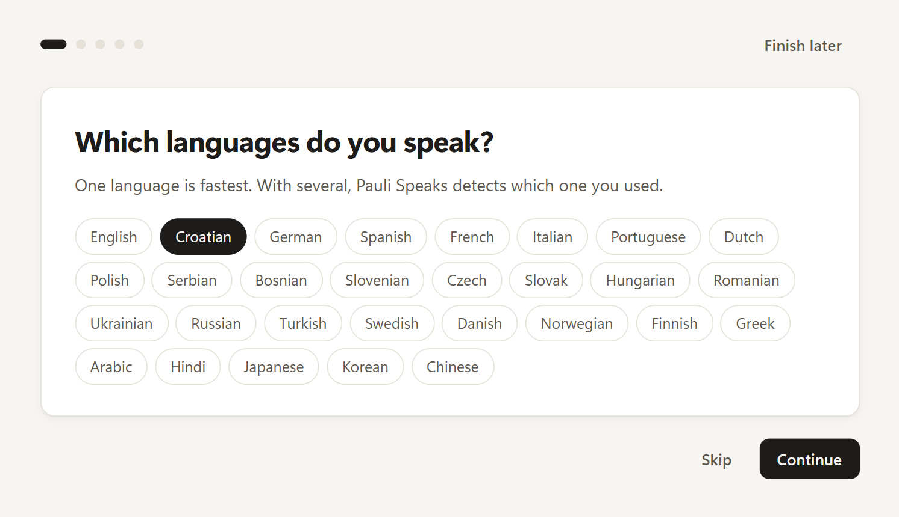
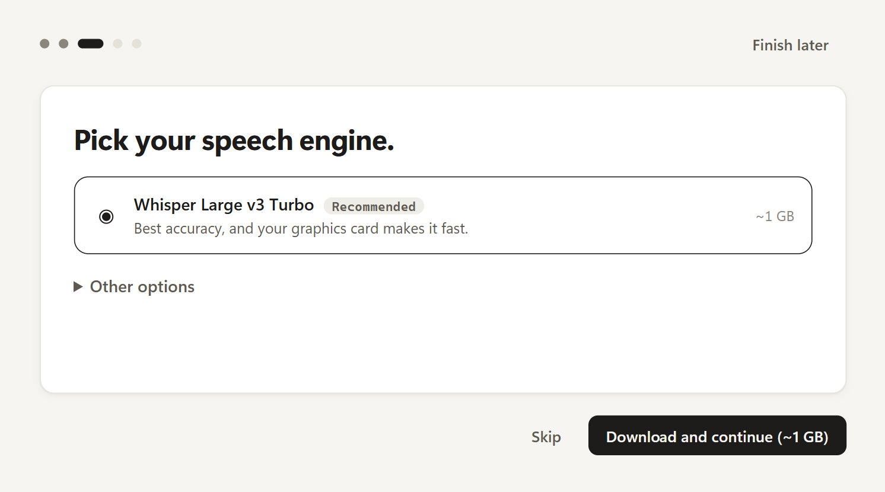
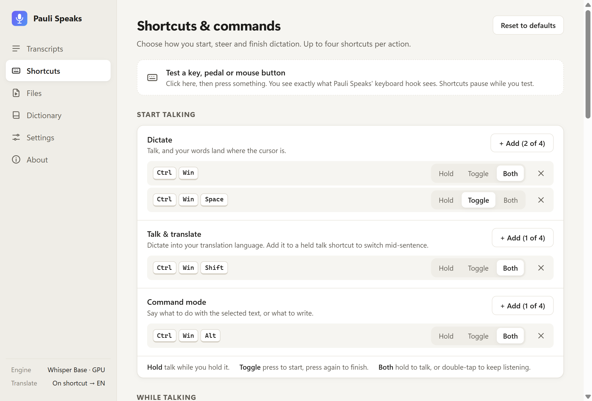
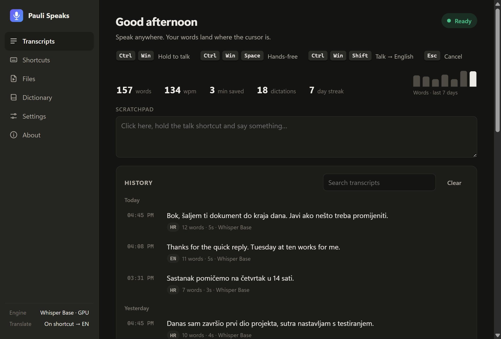

# Pauli Speaks

Free push-to-talk voice typing for Windows. Hold **Ctrl + Win**, speak, let go: your words
are typed into whatever app has the cursor. Speech recognition runs **on your own PC**
(OpenAI Whisper), so it is free, works offline and nothing you say leaves your computer.

**Download:** grab the latest `Pauli-Speaks-Setup-x.y.z.exe` from
[Releases](https://github.com/izscaryu/pauli-speaks/releases/latest). Installed copies update
themselves. Can't install software on this PC? Use the [portable copy](#portable-copy).

[Privacy](PRIVACY.md): what stays on your PC and what doesn't. · [Open-source licences](THIRD_PARTY_NOTICES.md) · [Code signing policy](docs/code-signing-policy.md)

## Screenshots



While you talk, a small pill at the bottom of the screen shows that it's listening (and, if you
turn on *Live preview*, the words so far):



On first start, a short guided setup asks which languages you speak, checks your microphone,
suggests a speech engine for your PC and tests your shortcut:

| Your languages | Your speech engine |
|---|---|
|  |  |

| Shortcuts | Dark mode |
|---|---|
|  |  |

### "Windows protected your PC"

When you run the installer, Windows may show a blue **"Windows protected your PC"** screen
with *Publisher: Unknown publisher*. To install anyway, click **More info**, check that the file
is `Pauli-Speaks-Setup-x.y.z.exe`, then click **Run anyway**.

This happens because the installer is not code-signed yet. Microsoft Defender SmartScreen warns
about any download that has no publisher signature or that few people have run; it does not
mean a virus was found. Every installer is built from this repository's public source by
[GitHub Actions](.github/workflows/release.yml), so download it only from
[Releases](https://github.com/izscaryu/pauli-speaks/releases). Signing the installer is planned;
the [code signing policy](docs/code-signing-policy.md) shows its current status.

### Portable copy

`Pauli-Speaks-Portable-x.y.z.exe` (on the same Releases page) runs without installing, for
example from a USB stick or on a work PC. Put it in a folder of its own and run it. It keeps
everything (settings, history, speech models, logs) in a **`Pauli Speaks Data`** folder next to
the `.exe`, and nothing in `%APPDATA%`. If that folder can't be written (a read-only drive), it
falls back to `%APPDATA%\Pauli Speaks\`.

Differences from the installed app:

- **No automatic updates.** It checks GitHub for a new version and About offers a **Download**
  button; replace the `.exe` with the new one and keep the `Pauli Speaks Data` folder.
- **No `pauli-speaks://` links and no Start with Windows**, so it leaves nothing in the
  registry. The command-line flags work with the portable `.exe`, but each call unpacks the app
  again first, so they are slow.
- It starts a few seconds slower, because it unpacks itself into a temp folder every time.

An unpacked build folder (`dist/win-unpacked`) becomes portable the same way when you put an
empty file named `portable` next to `Pauli Speaks.exe`.

## Features

- **Guided setup** the first time you start: pick your languages, check your microphone, choose a
  speech engine (it suggests one for your PC and shows what will be downloaded, and downloads
  nothing until you confirm), check your shortcut, and try a first dictation. *Settings → Run
  setup again* opens it again.
- **Push-to-talk**: hold the shortcut while you speak, release to paste.
- **Hands-free**: double-tap the shortcut (or press Ctrl + Win + Space) to keep recording,
  then press it again to finish. Up to 20 minutes per dictation.
- **Esc** cancels, **Shift + Alt + Z** pastes the last transcript again. A cancelled dictation
  shows **Cancelled. Undo** on the pill for 4 seconds, in case you pressed Esc by mistake.
- **Silence detection**: a small voice-detection model (Silero VAD) runs on your PC, so only the
  parts where you speak go to the speech engine. If you say nothing, nothing is typed and the pill
  says **No speech detected**; if the microphone delivers no sound at all, it says **No sound. Is
  your mic muted?** (and warns you after 2 seconds, while you are still recording). Hands-free
  auto-stop also listens for speech instead of loudness, so background noise doesn't keep it
  running. Turn it off with *Settings → Dictation → Silence detection* if words get cut.
- **Nothing gets lost**: if a dictation can't be transcribed (the cloud service is unreachable, say),
  the pill and the entry in History offer **Retry**. If Pauli Speaks crashes while you dictate,
  Home asks **Recover your last dictation?** the next time you start it.
- **Administrator windows**: Windows blocks pasting into an app that runs as administrator, so the
  text is left on the clipboard instead and the pill says **Copied. Press Ctrl+V (this app runs as
  administrator)**. The text you dictate is kept out of Windows clipboard history (Win+V).
- **Privacy controls** in *Settings → Privacy*: keep your transcript history, delete it after
  24 hours or don't keep it; optionally keep the recording of each dictation for 24 hours (play it
  back or transcribe it again from History); switch crash recovery off; **Delete all my data** and
  **Delete downloaded models**. [PRIVACY.md](PRIVACY.md) lists every file and connection.
- **Your own shortcuts** on the Shortcuts page: up to four per action, each set to *Hold*,
  *Toggle* or *Both* (hold, or double-tap to lock). 1–3 keys, a single F-key (F13–F24 for pedals
  and Stream Deck), a right-side modifier, a mouse button, or a **double-tap** of Ctrl, Alt or
  Shift. Windows-reserved combinations are refused; Ctrl+C-style app shortcuts ask first.
  A *Test a key* box shows exactly what the keyboard hook sees.
- Extra actions: copy last transcript, **undo last dictation**, **press Enter**.
- **Links and command line** for Stream Deck, AutoHotkey or pedal software:
  `pauli-speaks://dictate/toggle` (also `start`, `stop`, `cancel`), or
  `"Pauli Speaks.exe" --toggle` (also `--start`, `--stop`, `--cancel`, `--paste-last`,
  `--copy-last`, `--undo-last`, `--press-enter`). Links only control dictation, since any web
  page can open one.
- **Local Whisper** (Tiny / Base / Small / Large v3 Turbo). The model downloads once and then
  runs offline.
- Optional **cloud mode** with any OpenAI-compatible API (Groq's free tier by default), with
  your key encrypted by Windows.
- Multi-language: pick the languages you speak (English, Croatian, …) and it detects which one
  you used, within your list, also with the cloud engine. If you keep speaking a language that
  isn't on your list, Home asks "Sounds like <language>. Add it to your languages?" once.
- **Speak one language, paste another**: turn on *Always translate*, or hold **Ctrl + Win + Shift**
  (adding Shift to a held Ctrl + Win also works mid-sentence) to dictate in Croatian and paste
  English. *Fast* uses Whisper's built-in translator (English only, no extra download). *Best*
  uses Meta's NLLB-200 offline (30+ target languages, ~900 MB one-time download, ~2–3 s per
  sentence).
- Cleanup: removes "um/uh", sentence capitalization, and a personal dictionary for names and
  jargon. Dictionary words are also fed to Whisper as a prompt, so it hears them right the first
  time.
- **Voice commands you can edit**, in any language: "new line" / "novi red" anywhere in a
  sentence; "send it" / "pošalji" (press Enter) and "scratch that" / "obriši to" (remove the last
  dictation) at the start or end of what you say.
- **GPU acceleration** via DirectML (any DX12 GPU), with an automatic CPU fallback: 2–3× faster
  (Whisper Small: 3.1 s → 1.5 s for 7.6 s of speech on an RTX 3060 laptop).
- **Snippets**: say "my email" and your address is typed.
- **App styles**: no capitals or final full stop in code editors and terminals, no final full stop
  in chat apps, and always-punctuated text in Outlook and Word. Editable per app.
- **Command mode** (Ctrl + Win + Alt): select text and say "make this more formal" or "translate to
  German", or say what to write with nothing selected. Uses a free Groq key.
- **Read aloud** (Shift + Alt + S): reads the selected text with Windows voices.
- **Transcribe files**: drop audio or video and save a `.txt` or `.srt`, optionally translated.
- **Live preview** of your words while you speak, and **auto-stop** after silence in hands-free
  mode. Both are opt-in.
- Weekly words chart and a day streak.
- Floating status pill with a live waveform, start/stop sounds, history with copy, and
  stats (words, WPM, time saved).
- **Settings backup**: *Settings → Backup* exports your shortcuts, voice commands, dictionary,
  snippets and app styles to a file and imports them again. API keys are never included.
- Home warns you if the shortcut can't be seen, if another dictation app is running, or if the
  speech model needs downloading again, and shows what's new after an update.
- Restores your clipboard after pasting, runs in the tray, and can start with Windows.

## Run it

Requirements: Windows 10/11 x64, Node.js 22+.

```bash
npm install
npm start
```

On first start the guided setup opens. When you confirm the speech engine it downloads the model
(Whisper Base is ~150 MB) and shows the progress. The last step is a box to hold **Ctrl + Win**
in, say something and release.

## Build an installer

```bash
npm run dist
```

This creates `dist/Pauli-Speaks-Setup-<version>.exe`. Use `npm run dist:portable` for the
[portable](#portable-copy) `dist/Pauli-Speaks-Portable-<version>.exe`.

## Updates and releases

The installed app checks
[GitHub Releases](https://github.com/izscaryu/pauli-speaks/releases) 15 seconds after it starts
and then every 6 hours (`electron-updater`). It downloads new versions in the background and
offers **Restart to update** in the tray, the main window and About. If you ignore that, the
update installs the next time you quit.

**Early versions:** turn on *About → Get early versions* to also get pre-releases
(`x.y.z-beta.N`) before everyone else. You still get every regular release: when a newer
regular version comes out, you move to it. Turning the option off again doesn't go back a
version; you stay on the beta until the next regular release passes it.

Releases are built by GitHub Actions, not on a developer's PC. To publish a new version, with
everything committed and pushed on `main`:

```bash
npm run release -- 1.1.0
```

(or `patch`, `minor`, `major`). This runs the tests, sets `"version"` in `package.json`, commits
"Release v1.1.0", tags it `v1.1.0` and pushes both. The tag starts
[`.github/workflows/release.yml`](.github/workflows/release.yml), which builds the installer
and the portable `.exe`, checks that `latest.yml` (the file the updater reads) matches the
installer exactly, and creates the GitHub release with the installer, its `.blockmap`,
`latest.yml` and the portable `.exe`. `npm run release -- 1.2.0-beta.1` publishes a
**pre-release** that only *Get early versions* users receive; only `-beta.N` versions are
accepted. [docs/RELEASING.md](docs/RELEASING.md) is the full checklist, including the
VirusTotal scan and what to do if Microsoft Defender flags a release.

Every push and pull request runs the tests in [CI](.github/workflows/ci.yml).

## Tests

```bash
npm test
```

## How it works

```
uiohook-napi (WH_KEYBOARD_LL / WH_MOUSE_LL on a native thread)
   └─► shortcut-engine.js     exact key-set matching, double-taps, auto-repeat filter, stale-key eviction
        └─► dictation-controller.js   hold / toggle / both per shortcut, double-tap lock, cancel, 500 ms debounce
             ├─► overlay window   mic capture (AudioWorklet, 16 kHz mono) + status pill
             ├─► asr/             Whisper in an Electron utility process (or cloud API)
             ├─► text-cleanup.js  fillers, voice commands (voice-commands.js), dictionary
             └─► paster.js        clipboard snapshot → Ctrl+V via SendInput → restore
remote.js   pauli-speaks:// links and --flags, from startup argv and second-instance launches
```

| File | Purpose |
|---|---|
| `src/main/main.js` | App wiring: tray, windows, IPC, dictation pipeline |
| `src/main/keyboard.js` | Global hook adapter + Start-menu masking for Win-key shortcuts |
| `src/main/shortcut-engine.js` | Exact key-set matching, double-taps, stale-key eviction |
| `src/main/dictation-controller.js` | Push-to-talk / hands-free state machine |
| `src/main/shortcut-rules.js` | Actions, limits, validation (reserved, duplicates, warnings) |
| `src/main/shortcut-recorder.js` | The recorder behind *+ Add* on the Shortcuts page |
| `src/main/voice-commands.js` | Editable voice commands and their matching |
| `src/main/remote.js` | Deep links and command-line flags |
| `src/main/last-paste.js` | What *Undo last dictation* / "scratch that" may take back |
| `src/main/settings.js` | `settings.json`, with a `settingsVersion` and the list of migrations between versions |
| `src/main/system-check.js` | Local checks for the guided setup: system languages, GPU, model recommendation, other dictation apps |
| `src/main/welcome-ipc.js` | Main-side handlers for the guided setup |
| `src/main/settings-backup.js` | What *Export settings* / *Import settings* may read and write (never API keys) |
| `src/main/win32.js` | `SendInput` / `GetAsyncKeyState` via koffi |
| `src/main/paster.js` | Text insertion with clipboard restore |
| `src/main/asr/whisper-local.js` | Whisper via transformers.js + onnxruntime-node, language detection |
| `src/main/asr/cloud.js` | OpenAI-compatible `/audio/transcriptions` client |
| `src/renderer/overlay.*` | Floating pill + microphone recorder |
| `src/renderer/app.*` | Main window (Home, Shortcuts, Files, Dictionary, Settings, About) |

Data lives in `%APPDATA%\Pauli Speaks\` (a portable copy: `Pauli Speaks Data\` next to its
`.exe`, see `src/main/portable.js`): `settings.json`, `history.json`, `models\`, `logs\`, and
only when needed `audio\` (recordings you chose to keep) and `recovery\` (the dictation in progress).
Uninstalling asks whether to delete this folder too (the default is to keep it); updates never
touch it. The uninstaller also removes the `pauli-speaks://` link handler and the
start-with-Windows entry that the app registered ([`build/installer.nsh`](build/installer.nsh)).

## Troubleshooting

- **Nothing happens when I hold Ctrl + Win.** Another dictation app (e.g. Wispr Flow) might be
  using the same shortcut. Quit it or change the shortcut on the Shortcuts page. Home says so when
  it sees one running.
- **"Pauli Speaks can't see your shortcut."** The keyboard hook that watches for your shortcut
  didn't start. Security or antivirus software sometimes blocks it: allow Pauli Speaks there,
  then restart Pauli Speaks (right-click the tray icon → *Quit Pauli Speaks*, then start it
  again). If the banner stays, restart the PC. Separately, while an app running as administrator
  is in front, Windows hides your keys from Pauli Speaks unless it also runs as administrator.
  The log says why the hook failed: *About → Logs* opens the folder with `pauli-speaks.log`.
- **Something in the setup was skipped or went wrong.** Go to *Settings → Run setup again* to go
  through languages, microphone, speech engine and shortcut once more.
- **Text doesn't appear in one specific app.** Windows blocks simulated input into apps running
  as administrator unless Pauli Speaks also runs as administrator. When the app in front runs as
  administrator, Pauli Speaks leaves the text on the clipboard and the pill says to press Ctrl+V.
  If that didn't happen, use **Paste last transcript**, or copy from History.
- **"No sound. Is your mic muted?"** The microphone delivered nothing but silence. Check that it
  isn't muted (a hardware mute switch or key, or the mute in Windows sound settings), that
  *Settings → Microphone* is set to the microphone you are using, and that Windows lets desktop
  apps use it (see "Microphone blocked" below). *Settings → Run setup again* tests the microphone.
- **"No speech detected" although I spoke.** Silence detection thought it heard no speech, for
  example in a very quiet recording or with a distant microphone. Speak closer to the microphone, or
  turn off *Settings → Dictation → Silence detection* to go back to the simple loudness check.
- **"Couldn't transcribe. Retry".** The speech engine failed or the cloud service couldn't be
  reached. Click **Retry** on the pill (it stays for a few seconds) or on the entry in History;
  the recording is kept in memory until you quit Pauli Speaks.
- **"Microphone blocked".** Turn on *Windows Settings → Privacy & security → Microphone → Let
  desktop apps access your microphone*.
- **Slow transcription.** Use Whisper Base or Tiny, pick a single language, or switch to cloud
  mode with a free Groq key.
- Developer self-test: put a 16 kHz `speech.wav` in a folder and run with
  `PAULI_SELFTEST=<folder>`. The app transcribes the file, writes `selftest.json` and window
  screenshots to that folder, then quits.
